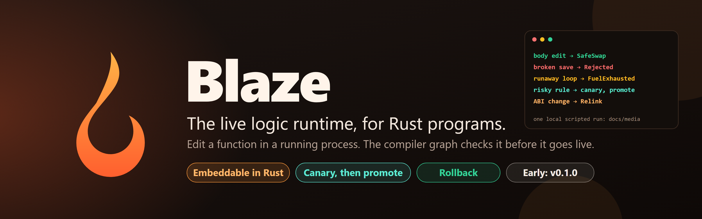
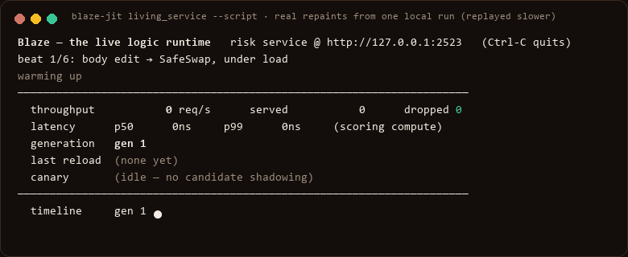
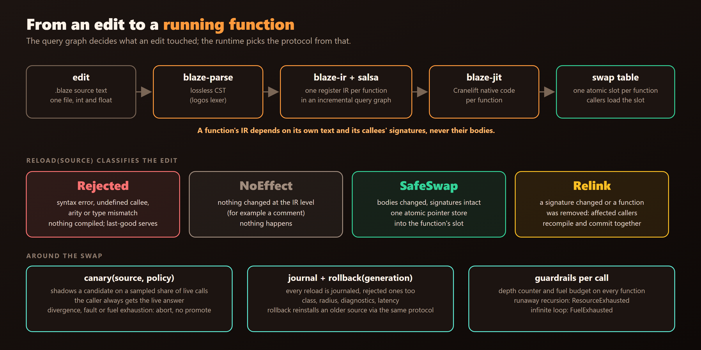
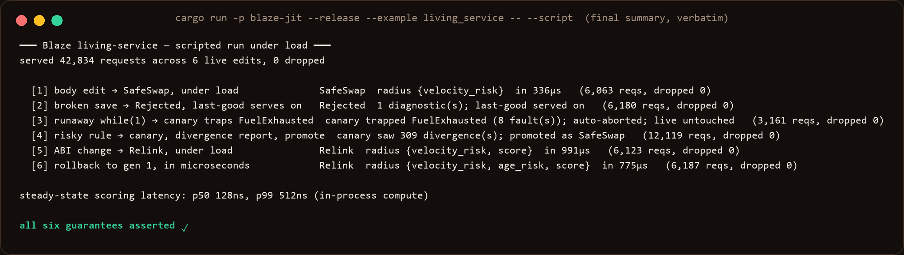
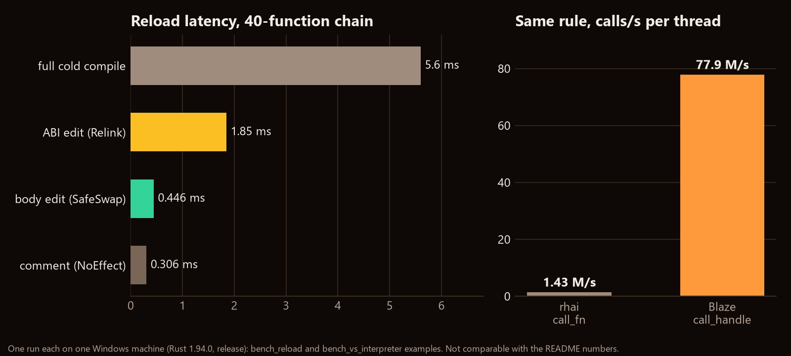

> ⭐ **GitHub: [github.com/grloper/Blaze](https://github.com/grloper/Blaze)** · source on GitHub, no LICENSE file yet (Cargo.toml declares Apache-2.0) · by [@grloper](https://github.com/grloper)





Hot reload is usually bolted onto a build system that does not know what an edit changed. Tools diff files, guess which functions are affected, and hope the ABI did not move. I wanted to try the opposite: build the incremental compiler first, and let its dependency graph answer the question "what did this edit actually touch?" The result is Blaze, an embeddable language for Rust programs. It is early (version 0.1.0), tested mainly on Windows, and I would like it reviewed rather than believed.

One licensing note up front: the workspace `Cargo.toml` says `Apache-2.0`, but the repository has no `LICENSE` file yet, so GitHub shows no license. Until that is fixed, treat the code as readable but not clearly reusable.



*A real run of `cargo run -p blaze-jit --release --example living_service -- --script` on my Windows machine (Rust 1.94.0). The GIF replays the dashboard's actual repaints, slowed down: the real run is over in seconds. Every beat is asserted by the example itself.*

### The idea: a firewall in the query graph

Blaze parses into a lossless CST, lowers each function to a small register IR inside a salsa query graph, and compiles with Cranelift. The key rule is that a function's lowered IR depends on its own text and on its callees' signatures, never their bodies. Edit a body and callers are untouched; change a signature and every caller is pulled into the recompile set. The blast radius falls out of the graph as a by-product of recompiling.



The runtime then picks a protocol from that:

| What changed | Class | What happens |
|---|---|---|
| A syntax error, undefined callee, arity or type mismatch | Rejected | Nothing is compiled; the previous version keeps serving |
| Nothing at the IR level (a comment) | NoEffect | Nothing |
| Bodies only, signatures intact | SafeSwap | One atomic pointer store into the function's slot |
| A signature changed or a function was removed | Relink | The affected callers recompile and commit together under a quiescence barrier |

Every Blaze-to-Blaze call is an acquire-load of the callee's slot plus an indirect call, so generated code has no relocations against other functions. That is why a swap can be one store.

### Guardrails for bad edits

A live process should survive a bad edit, so every function threads a per-call context with a depth counter and a fuel budget (one unit per call and per loop back-edge). Unbounded recursion returns `ResourceExhausted`; an infinite loop returns `FuelExhausted`. Division by zero is guarded. The language has only `int` (i64) and `float` (f64) and no memory operations, which is part of why a script cannot corrupt the host.

### Canary and rollback

`canary(source, policy)` compiles an isolated candidate and shadows it on a sampled fraction of live calls. The caller always receives the live answer. A candidate that diverges, faults or runs out of fuel aborts and cannot be promoted. Every reload, including rejected ones, is journaled with its class, radius, diagnostics and latency, and `rollback(generation)` reinstalls an earlier source through the same protocol.

### The demo, and what it does and does not show

`living_service` is an HTTP scoring service whose logic is a `.blaze` file. Its scripted mode makes six live edits under load: a body edit, a broken save, a runaway loop caught by the canary, a risky rule promoted after divergence, an ABI change, and a rollback. This is what the example printed at the end of my run:



In that run 42,834 requests were served across the six edits and none were dropped; the body-edit swap committed in 336 microseconds. The README quotes a different run (51,815 requests, 496 microseconds). Those are two local runs on two machines, so read both as "same order of magnitude", not as a spec. I also ran `cargo test --workspace --release` on the same machine: 110 tests passed, 0 failed. Many of them hammer swaps from a second thread.

The README states the audit ran on Windows and that Linux and macOS were not re-run. My run is also Windows only.

### Numbers, with caveats

I ran the repo's benchmark examples once each on my Windows machine. Single runs, release mode: treat them as orders of magnitude.



*Left: `bench_reload`. Right: `bench_vs_interpreter`. Both from `blaze-jit/examples`, run by me on one machine; the README lists its own numbers from a shared cloud container, which differ.*

On the 40-function chain, a body edit swapped in about 0.45 ms against 5.6 ms for a full cold compile. In `bench_vs_interpreter`, one branchy rule, cross-checked to give identical answers, ran roughly 54 times faster through a native `FuncHandle` than through `rhai`'s compiled-AST `call_fn`. That is one rule against one interpreter; it says nothing general about interpreters. `bench_calls` also reports a handle-based call path at about 83 M calls/s on one thread for a trivial leaf, which measures dispatch cost, not useful work.

### Quickstart

```bash
git clone https://github.com/grloper/Blaze && cd Blaze   # needs Rust 1.94+
cargo test --workspace
cargo run -p blaze-jit --release --example living_service -- --script
```

The Rust 1.94 requirement is real: on 1.91 the build stops because the locked Cranelift crates need 1.94. On Windows I used the GNU toolchain (`x86_64-pc-windows-gnu`) with MinGW on `PATH`.

Embedding:

```rust
use blaze_jit::{LiveRuntime, EditClass};

let rt = LiveRuntime::new("int add(int a, int b) { return a + b; }")?;
assert_eq!(rt.call("add", &[2, 3]), Ok(5));
let report = rt.reload("int add(int a, int b) { return a + a + b; }")?;
assert_eq!(report.class, EditClass::SafeSwap);
assert_eq!(rt.call("add", &[2, 3]), Ok(7));
```

### Honest limits

- One source file and one flat namespace. No modules, strings, arrays or structs, and no implicit int/float conversion.
- State lives in the host. Migrating script-owned data is not something Blaze does; `StateMigration` is reserved and cannot occur today.
- Retired code generations are kept for the life of the runtime, so memory grows with the number of edits.
- An active canary re-executes sampled calls, so it only suits functions without observable side effects.
- Watch mode is mtime polling, not OS file events.
- "Proven" in the README means tested, not formally verified. There has been no independent security review and no production use.
- No LICENSE file yet (see the note at the top).

### Try it, and help

The most useful thing is critique of the swap protocol: where could a concurrent caller observe a torn state that my tests do not cover? Run the examples on Linux or macOS and tell me what breaks. Issues and PRs welcome at [github.com/grloper/Blaze](https://github.com/grloper/Blaze). Roadmap items are richer types, explicit conversions, and script-owned state migration.
